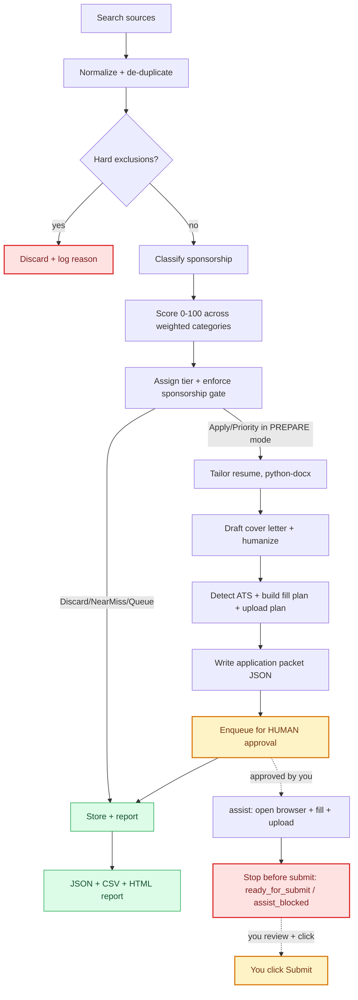

> [Back to the project overview](../README.md) ? [Documentation index](README.md)

<div align="center">

# Job Agent

Local-first job discovery, deterministic scoring, human-approved applications

   

It finds the roles, scores the fit, tailors the resume, and fills the form.<br>
**You click Submit.**

<sub>DESIGNED AND ENGINEERED BY&nbsp;&nbsp;<b><i>Atresh Somayajula</i></b></sub>

</div>

Every strong match becomes a reviewable **application packet**: the job, its score, a tailored resume, a cover letter, the detected ATS, and a per-field fill plan. Approve one and the agent opens the apply page in a real browser and fills it in. Everything runs on your machine, the dashboard binds to `127.0.0.1`, your profile and screening answers live in gitignored local config, and credentials are read from local configuration. External providers receive the credentials needed for enabled API calls; approved form filling sends your selected application data to the employer.

> [!IMPORTANT]
> **The agent fills and uploads, then stops before the final Submit.** There is exactly one automated submit path, and it needs you to opt in *for that specific run*, on a clean form, within a daily cap. Even then a job counts as applied only once the submission is **verified**. Full detail in the [Safety model](#-safety-model).

## 🗺️ Contents

<table>
<tr>
<td width="25%"><b>Start here</b><br><a href="#requirements">Requirements</a> · <a href="#installation">Install</a><br><a href="#first-time-configuration">Configure</a> · <a href="#preflight-check">Preflight</a><br><a href="#your-first-run">First run</a></td>
<td width="25%"><b>Understand it</b><br><a href="#-what-it-does">What it does</a><br><a href="#-the-pipeline">The pipeline</a><br><a href="#-safety-model">Safety model</a> · <a href="#-run-modes">Run modes</a></td>
<td width="25%"><b>Use it</b><br><a href="#-search-profiles">Search profiles</a> · <a href="#-the-dashboard">Dashboard</a><br><a href="#-command-reference">Commands</a> · <a href="#-browser-assisted-apply">Browser assist</a><br><a href="#-chrome--edge-extension">Extension</a></td>
<td width="25%"><b>Tune it</b><br><a href="#-discovery-sources">Discovery sources</a><br><a href="#-performance-notes">Performance</a><br><a href="#-configuration-files">Config</a> · <a href="#-optional-llm-assist">LLM assist</a></td>
</tr>
<tr>
<td colspan="4"><b>Reference</b> · <a href="#-project-layout">Project layout</a> · <a href="../docs/README.md">Documentation</a> · <a href="#-tech-stack">Tech stack</a> · <a href="#-testing-and-verification">Testing</a> · <a href="../docs/SUPPORT_MATRIX.md">Support matrix</a></td>
</tr>
</table>

## 🧭 What it does

<table>
<tr><th width="50%">Find and judge</th><th width="50%">Prepare and hand over</th></tr>
<tr valign="top">
<td><b>1. Finds jobs</b> from public ATS endpoints (Greenhouse, Lever, Ashby, Workday, SmartRecruiters, Workable), aggregator APIs, public JSON-LD pages, and CSV or URL lists you supply.<br><br><b>2. Normalizes and de-duplicates</b> everything into one canonical shape in local SQLite.<br><br><b>3. Excludes</b> the disqualifiers: no sponsorship, clearance required, too junior, wrong employment type, wrong geography, stale.<br><br><b>4. Classifies sponsorship</b> as Confirmed, Likely, or Unconfirmed.<br><br><b>5. Scores 0-100</b> across weighted, config-driven categories (10 on the shipped config, 13 on the legacy shape).<br><br><b>6. Assigns a tier</b> and applies the sponsorship gate.</td>
<td><b>7. Tailors your resume</b> by emphasizing skills you <i>already have</i>. It never invents one.<br><br><b>8. Drafts a cover letter</b> of 180-260 words, humanized, and only when the job warrants it.<br><br><b>9. Builds a packet</b> holding the detected ATS, the fill plan, screening answers, and the upload plan.<br><br><b>10. Queues it for your approval.</b><br><br><b>11. Assists the apply</b> if you want it to: real browser, fills fields, uploads documents, advances the safe steps, and <b>stops before Submit</b>.</td>
</tr>
</table>

## 🔒 Safety model

This is the one authoritative statement of what the agent will and will not do. Every other section defers to it.

| | Rule |
|:--:|---|
| **1** | **Never bypasses** CAPTCHAs, bot protection, paywalls, login walls, MFA, rate limits, or any other platform security control. |
| **2** | **Prefers official surfaces**: public APIs, RSS feeds, public job pages, ATS endpoints, and URLs you supply. |
| **3** | **No stealth.** No webdriver hiding, no fake user agents, no aggressive scraping. Outbound requests carry a `User-Agent` that names this tool honestly. |
| **4** | **Never fabricates** candidate data. Not resume content, skills, certifications, history, salary, education, or immigration status. |
| **5** | **Human-gated submit.** Search, score, tailor, and fill *planning* are automatic. The final Submit is not. |
| **6** | **Truthful work authorization, always.** The agent will not claim "no sponsorship required." |
| **7** | **Ambiguity comes back to you.** Legal, immigration, salary, and relocation questions pause and ask. |
| **8** | **Every packet is fully reviewable** before anything happens. |

### The submit boundary

The default path never submits. Once it has filled and uploaded everything it can, the runner leaves the job at `ready_for_submit` with the browser open on the final page, or at `assist_blocked` when it needs your input. You review it and click Submit.

<table>
<tr><th width="46%">The one automated path</th><th width="54%">Every gate it has to clear</th></tr>
<tr valign="top">
<td><code>applyRunner.tryAutoSubmit</code><br><br>It exists so a clean, verified, explicitly authorized application can finish without a second trip to the keyboard. Nothing else.<br><br><code>npm run verify</code> asserts these gates are still in place.</td>
<td>✅ You opted in <b>for that specific run</b> (<code>options.autoSubmit === true</code>, and the dashboard asks every time)<br>✅ Zero blockers, every required field filled<br>✅ Truthful sponsorship answers<br>✅ A confidently identified submit button<br>✅ Daily cap not yet reached (<code>MAX_APPLICATIONS_PER_DAY</code>, default 15, counted in <b>your</b> time zone)<br>✅ A fixture-verified ATS — an unrecognised (<code>generic</code>) site is fill-only, never auto-submitted<br>✅ The packet was approved <b>before</b> the run started, and belongs to the active candidate<br>✅ Every visible required control on the live page has a value<br>✅ No sponsorship or legal answer was chosen live that you had not reviewed in the packet</td>
</tr>
</table>

> [!WARNING]
> **A click is not proof.** A job is recorded as submitted only when the runner *verifies* it, meaning a confirmation page or a redirect with the form gone. An unverified click surfaces as `submit_unverified` for you to confirm. It is never quietly counted as an application.

> [!CAUTION]
> **The sponsorship-polarity guard.** Pattern matching cannot tell polarity apart, so a question phrased negatively ("can you work here *without* sponsorship?") is never auto-answered. Inverting the stored answer would amount to guessing about your immigration status. Those questions always come back to you, both at fill time and when you save an answer from the dashboard.

<details>
<summary><b>🧯 Guards on the fill path</b>: what the runner refuses to do on its own</summary>

- **Never picks a legal answer by default.** On sponsorship, visa, work-authorization, citizenship, clearance, consent, attestation and EEO fields, a dropdown or typeahead never falls back to its top option or to Enter, options match on whole words only ("No" can no longer match inside "now"), and the option actually committed is **read back and checked**. If it contradicts your stated authorization the field is cleared and the run stops for you.
- **Only the active candidate's packet is filled.** A packet built for another search profile — or an old packet with no recorded owner whose documents are not named for you — is refused at every entry point (dashboard, CLI, one-by-one apply, extension). Prepare it again.
- **No template text reaches an employer.** A cover letter or planned answer containing an unfilled `{token}` is refused, and placeholder profile values (including work-history highlights, employer and school names) block preparation.
- **Walls are judged by what the page shows**, not by vendor names inside its scripts, so a healthy application page is no longer mistaken for a bot wall.
- **Documents go into the input labelled for them**: the resume never lands in a cover-letter or transcript slot, on current `job-boards.greenhouse.io` markup as well as the classic layout.
- **Your own submit is noticed.** After hand-off the runner watches the open window; if a confirmation page appears it records the job as *submitted — pending your confirmation*. It still never counts as applied until you click **I submitted it myself**.

</details>

## 🚀 Getting started

### Requirements

| Dependency | Version | Why |
| --- | :---: | --- |
| **Node.js** | **≥ 22.13** | The built-in `node:sqlite` module works without a flag from 22.13 (22.x and 24.x are tested in CI; `.nvmrc` pins 22.13) |
| **Python** | 3.12 | Resume editing through `python-docx` |
| **Playwright Chromium** | *`npx playwright install chromium`* | Browser-assisted form filling |
| MS Word | *optional* | Only for `docx2pdf` PDF export |

### Installation

```bash
npm ci                             # Node dependencies, exactly as package-lock.json pins them
npx playwright install chromium    # the BROWSER itself — a separate download
npm run setup                      # seed your personal config from the examples (never overwrites)
cp .env.example .env               # then edit it. DRY_RUN needs no secrets
```

**Python (resume tailoring).** Use a virtual environment. On macOS (Homebrew)
and recent Debian/Ubuntu a bare `pip install` into the system Python is refused
with `externally-managed-environment` (PEP 668) — that is the OS protecting
itself, and a venv is the fix, not `--break-system-packages`:

```bash
python3 -m venv .venv
.venv/bin/pip install -r requirements.txt          # Windows: .venv\Scripts\pip install -r requirements.txt
echo "PYTHON=.venv/bin/python" >> .env              # Windows: PYTHON=.venv\Scripts\python.exe
```

Python **3.12** is the supported version everywhere (CI runs 3.12).

The launchers below do the Node half for you: they re-run `npm ci` whenever
`package-lock.json` has changed since the last install (not only when
`node_modules` is missing), seed missing config, and offer to download
Chromium.

`npm ci` does **not** download the browser. This repo has no `postinstall`
hook, so the Chromium binary has to be fetched by the second command above;
without it, discovery and scoring work fine and anything that opens a browser
fails at the point of use. `npm run doctor` reports whether it is present.

### First-time configuration

Three things need your input before the first real run.

**1. Your profile.** Create your personal files from the shipped examples, then fill them in with real information:

```bash
npm run setup          # npm run setup:check reports what is missing without writing
```

It creates, **only when absent**, `config/candidate.json`, `config/screening_answers.json`, `config/cover_letter.json` (your years of experience and work-authorization sentence for cover letters) and a synthetic `resumes/base/MASTER_RESUME.docx`. They start as **placeholders**: `npm run doctor` fails, and nothing is prepared or submitted, until you replace the template values. All of them are **gitignored**, because they hold your personal data. You can also edit the contact fields from the dashboard under **More actions → Application profile**

**2. Your master resume.** Put it at `resumes/base/MASTER_RESUME.docx`. It is opened **read-only** and never overwritten, and tailored copies go to `resumes/output/`. From **More actions → Master resume** you can read the document's real extracted text, so you see what tailoring actually reads rather than just the filename. You can download it to edit, then upload a replacement. Uploads are validated before they land, so a renamed PDF or a file with no readable text gets refused, and the version being replaced is kept in `resumes/base/history/` for one-click rollback.

**3. Job sources.** The simplest input is a CSV at `data/jobs_input/manual_jobs.csv`:

```csv
source,company,title,location,url,jd_text,posted_at,applicant_count,employment_type
manual,Globex,Lead Data Engineer,"Remote, US",https://boards.greenhouse.io/globex/jobs/42,"Azure Databricks, PySpark, Delta Lake. Visa sponsorship available.",2026-06-02,17,Full-time
```

For live boards, enable sources in `config/jobboards.json`. Keyless cross-company search (`ats-search`) is already on by default, so see [Discovery sources](#-discovery-sources).

### Preflight check

```bash
npm run doctor        # alias: npm run preflight
```

You get one readable checklist covering Node version, SQLite, config schemas, required profile fields, the master resume, Python and `python-docx`, Playwright Chromium, output directory permissions, and test fixtures.

| Result | Meaning |
|:--:|---|
| ❌ **Failure** | Blocks the run |
| ⚠️ **Degraded** | A warning. For example, no Python means an untailored master-resume fallback |
| 📋 **Profile gap** | A field that is genuinely missing, like an empty street address or no GitHub URL |

> [!NOTE]
> Profile gaps are never invented. Fill them in `config/candidate.json` yourself, and only with real information. Add `--json` for machine-readable output. The exit code is 0 only when nothing failed.

### Your first run

<table>
<tr><th width="50%">🖥️ The dashboard (recommended)</th><th width="50%">⌨️ The guided CLI</th></tr>
<tr valign="top">
<td>Use the launcher for your platform. Each one checks Node, refreshes dependencies when the lockfile changed, seeds missing config, starts the server from the right folder, and opens your browser:<br><br>• <b>Windows:</b> double-click <code>start-job-agent.cmd</code> (or <code>start-dashboard.cmd</code>; pass a port like <code>start-dashboard.cmd 5000</code>)<br>• <b>PowerShell (any OS):</b> <code>pwsh ./Start-JobAgent.ps1</code><br>• <b>macOS / Linux:</b> <code>./start-job-agent.sh</code><br><br>Launching again while it runs just opens the running dashboard — it never starts a second one.<br><br>On any platform:<br><br><code>npm run app</code> does the same as the launchers minus the dependency step.<br><br><code>npm run dashboard</code> starts the server only, at <code>http://127.0.0.1:4646</code>.</td>
<td><code>npm start</code> runs the whole flow as one interactive session.<br><br>It finds, scores, and prepares in a single pass, lists the prepared packets, and asks which ones to approve. Type <kbd>a</kbd> for all, <kbd>n</kbd> for none, or a range like <code>1,3</code> or <code>1-2</code>.<br><br>Then it offers to open a browser and fill them, stopping before submit. It refreshes the Excel tracker at <code>data/job_tracker.csv</code> along the way.</td>
</tr>
</table>

## 👤 Search profiles

**This agent is not built for one person or one profession.** What it searches
for, what it recognizes, what it scores well and what it throws away all come
from a *search profile* you can create, edit and switch — with no code change.

### The one distinction that makes it work

A profile is two halves, and conflating them is the bug the whole model exists
to prevent:

| Half | What it is | Where it comes from |
| --- | --- | --- |
| **`background`** | *Evidence.* Roles held, years, skills, industries, seniority, education, certifications, leadership. | Parsed from your resume. |
| **`searchIntent`** | *Preference.* Target roles, desired level, locations, work mode, employment type, industries, pay, work authorization, skills to keep or grow into. | Stated by you. |

**Checked across professions and career stages.** A regression suite activates eight profiles end to end (an ICU nurse, a senior accountant, a construction project manager, a backend engineer, a VP of operations, an entry-level marketer, a teacher moving into instructional design, and a journeyman electrician) and requires each to rank its own role as a fit and the traps as not: a nurse recruiter is not a nurse, an executive assistant is not an executive, data entry is not data engineering. A few behaviours follow from that work:

- **Executive and department titles stay whole.** "VP of Operations" is searched and scored as itself and as "Head of / Director of / VP Operations", never as a bare "Operations" that would credit an operations coordinator.
- **Gaps are true statements.** A credential you hold ("RN" against "RN license required") or a degree on your profile ("BSN preferred") is not reported as missing; a skill you only list as one to grow into is.
- **Employment type in any spelling** ("Full-time", "permanent", "contract-to-hire") is accepted when a profile is activated.
- **Pay is compared only in US dollars.** Postings state pay in dollars, so a pay floor or target in another currency neither excludes nor penalizes anything; it is not converted at a rate that would be stale.

A resume says what you have **done**; your search says what you **want**. Those
diverge exactly when someone is changing direction — a career-changer's resume
is still full of the field they are leaving. So **uploading a resume never
rewrites your goals.** It fills `background`, and *proposes* a `searchIntent`
for you to accept, edit or decline.

### Uploading a different resume

When a resume arrives, the agent compares it to the active profile and says
which of three things it thinks happened — `same`, `evolved`, or `different`
candidate — with its reasons, then offers exactly three choices:

- **Create a search profile from this resume** — a new profile, saved but not
  active until you activate it.
- **Keep my current search goals** — an explicit no-op. The resume is still used
  for tailoring.
- **Merge selected roles and skills** — additive only; nothing you chose is removed.

It never silently keeps searching with another person's titles, and it never
silently replaces goals you set on purpose.

### Role discovery is derived, not literal

The agent does not just search the exact titles on your resume. From your
profile it derives:

```
resume → skills + experience → role families → title variations → discovery → full-description scoring
```

Families live in **`config/role_families.json`** — plain, editable data covering
~26 occupational families. There is no profession-specific branch anywhere in
the code; every family runs through the same matcher, so a title is only
rejected when it confidently belongs to a family *you are not in*.

Two lists come out of this, and they do different jobs:

| List | Job | Size |
| --- | --- | --- |
| `candidate.searchPhrases` | What is **sent** to job boards. Costs one request each. | A small set cover (2–4) |
| `candidate.targetTitles` | What is **recognized** and **scored**. Free. | Expanded (often 15–25) |

Worked examples, all produced by the same code with no branches:

| Profile | Search phrases | Also recognizes |
| --- | --- | --- |
| Senior Data Engineer | `"data engineer"` | Analytics Engineer, Data Architect, BI Engineer, Data Platform Engineer … |
| Regulatory Affairs Specialist | `"regulatory affairs"` | Regulatory Affairs Manager, Regulatory Submissions Manager, QA Specialist … |
| Marketing Coordinator (new grad) | `"marketing coordinator"` | Digital / Content / Product Marketing Manager, Brand Manager, Campaign Manager … |

### Commands

```bash
npm run profiles                     # list saved profiles, marking the active one
npm run profiles show                # what the active profile makes the agent DO
npm run profiles from-resume         # read the master resume; propose, write nothing
npm run profiles from-resume -- --save
npm run profiles preview <id>        # compute the full effect, write nothing
npm run profiles activate <id>       # switch: regenerates the runtime config
npm run profiles migrate             # import an existing candidate.json as profile #1
npm run profiles delete <id>
```

You can do all of this from the dashboard too — open **Master resume**, and the
profile panel sits at the top of the drawer.

### What activation actually does

`config/candidate.json` becomes a **generated view** of the active profile. That
is the seam that keeps every other module unchanged: the scorer, the adapters,
the form filler and the cover-letter writer all keep reading the files they
always read.

Activating a profile regenerates, keeping a `.bak` of each:

- `config/candidate.json` — target titles, search phrases, skills, preferences
- `config/scoring.json` → `categories` (bound to *your* titles and *your* skills) and `marketSkills` (the gap vocabulary for *your* field)
- `config/exclusions.json` → `roleMismatchDerived` (seniority rules from your **desired** level) and the US-only geography gate

> [!IMPORTANT]
> **Your own rules are never touched.** Derived values live in their own keys
> (`roleMismatchDerived`, `categories`, `marketSkills`). Anything you typed by
> hand — your `roleMismatch` phrases, tiers, sponsorship lists — survives every
> profile switch. If you hand-edit `candidate.json` after activating, `npm run
> doctor` warns you that the next activation will overwrite it.

> [!NOTE]
> Profiles are stored in `config/profiles/` and are 🔒 **gitignored** — they hold
> the same personal data `candidate.json` does, and more. The taxonomy they are
> matched against (`config/role_families.json`) is impersonal and **is** tracked.

## 🔄 The pipeline



| Stage | Module | What it does |
| --- | --- | --- |
| **Search** | `src/search/` | Calls public ATS APIs, parses JSON-LD from public job pages, imports your CSV and URL lists. No login automation, no stealth. |
| **Normalize** | `src/search/normalize.js` | Turns every source into one canonical job shape with a stable ID. |
| **De-duplicate** | `src/search/deduplicator.js` | Drops repeats and keeps the richer JD. Skips jobs you have already applied to (`EXCLUDE_ALREADY_APPLIED`). |
| **Freshness** | `src/search/freshnessFilter.js` | Keeps dated postings per `JOB_FRESHNESS_MODE`. Widens to 3 days automatically when a strict window comes back thin (`INCLUDE_LAST_3_DAYS_FALLBACK`). Undated board jobs go to a visible review bucket instead of being dropped quietly (`INCLUDE_UNKNOWN_DATE_JOBS`). |
| **Exclude** | `src/scoring/exclusionFilter.js` | Discards no-sponsorship, clearance, junior or unrelated, wrong-geo, and stale postings. |
| **Sponsorship** | `src/scoring/sponsorshipClassifier.js` | Confirmed, Likely, or Unconfirmed, read from JD phrases plus the known-sponsor list in config. |
| **Score** | `src/scoring/scorer.js` | Weighted categories (10 on the shipped config), normalized to 0-100. Fully deterministic. |
| **Tier and gate** | `src/scoring/explainScore.js` | Priority ≥ 85, Apply ≥ 75, Queue ≥ 60, Near miss ≥ 50, then the sponsorship gate. |
| **Tailor resume** | `src/resume/tailor.py` | Bolds the skills you already have that match the JD. Never fabricates. |
| **Cover letter** | `src/apply/coverLetter.js` | Deterministic template, humanized, 180-260 words, written only when warranted. |
| **Packet** | `src/apply/applicationPacket.js` | Bundles job, score, tier, resume, cover letter, ATS, fill plan, and upload plan. Always `submitReady: false`. |
| **Approval** | `src/apply/approvalQueue.js` | Writes the packet as `pending_review`. **This is the compliance choke point.** |
| **Assist apply** | `src/automation/applyRunner.js` | Opens the page, runs guards, fills, uploads, advances the safe steps, stops before submit. |
| **Page guards** | `src/automation/guards.js` | Spots CAPTCHA, login, MFA, and bot walls and forces a stop. It never evades them. |
| **Report** | `src/reports/reportGenerator.js` | Writes JSON, CSV, and HTML summaries to `reports/`. |

<details>
<summary><b>📐 Notable stage behaviors</b>: geography, the fit and sponsorship split, auto-prep scope, two-page discipline</summary>

**Geography.** The US-only gate reads its US signal from `src/utils/usGeography.js`, which covers all 50 states, DC, and the territories by name and by USPS code. So a US city that shares a name with a foreign one, like Dublin OH, Vienna VA, Ontario CA, Athens GA, or Cambridge MA, gets kept. Only a genuinely foreign location is dropped, and anything unknown or ambiguous is always kept for you to judge. C2C, 1099, part-time, and freelance arrangements stay visible and get classified for UI filtering.

**Fit and sponsorship are separate measurements.** The gate downgrades Apply and Priority to Queue unless sponsorship is acceptable or you approved it, but the dashboard still shows those gated 75+ roles as **strong fits** with a "⚠ verify sponsorship first" action. Fit measures how well the *role* matches. Sponsorship feasibility is reported next to it. The gate only blocks auto-preparation.

**Auto-preparation scope.** Only Priority and Apply tiers get prepared automatically. Queue-tier jobs are prepared only when you pick them yourself with "Prepare selected".

**Two-page resume discipline.** The tailor repairs layout artifacts like manual page breaks, merged role blocks, and blank filler, then holds the result to two pages by dropping whole low-relevance bullets from the oldest roles. It never shortens or rewords a claim, and never drops a role, its dates, or its last bullet. Whatever it omitted is listed for review. There is an optional per-job "Most relevant to this role" focus line, but it is **off by default** (`config.runtime.resumeFocusLine === true`).

</details>

## 🔀 Run modes

Valid modes are **`DRY_RUN`**, **`PREPARE`**, and **`LIVE_ASSIST`**, set through `RUN_MODE` or `--mode`. Anything unknown or legacy falls back to `DRY_RUN`.

| Phase | Command | Behavior | Browser? |
| --- | --- | --- | :---: |
| **Discover** | `npm run discover` | Search only, writing `data/found_jobs.json` with every job and what happened to it. No scoring, no secrets. | |
| **Score** | `npm run score` | Search and score, writing `scored_jobs.json` and `queued_jobs.json`. No packets. | |
| **Prepare** | `npm run prepare-apps` | All of the above, plus resume tailoring, cover letters, packets, and the approval queue. | |
| **Assist** | `npm run assist` | Opens **approved** packets in a real browser, fills and uploads, advances the safe steps, stops at `ready_for_submit`. | ✅ |
| **End-to-end** | `npm run end-to-end` | `prepare-apps` then `assist`, stopping at the human-approval boundary. | ✅ |

> [!NOTE]
> Unattended auto-submit is deliberately not possible. Submission happens when you click Submit, or when you opt in to auto-submit for a specific run, and even then only verified submissions get recorded. See the [Safety model](#-safety-model).
>
> To be exact about the opt-in: it is a single local API route (`POST /api/auto-submit-batch`) that requires `confirmed: true` plus a fresh server-side eligibility check. **No button in the shipped dashboard calls it** — it is reachable only if you invoke it deliberately. No CLI command can submit at all.

## 📊 The dashboard

A local-only web cockpit that binds to `127.0.0.1`, needs no extra dependencies, and drives the whole workflow from the browser. It opens on **Today** — a short action queue — with the full board one click away under **Jobs** and in-flight applications under **Applications** (the same board, scoped to application stages); the selected-job inspector sits in the right column (a side sheet on laptops, a bottom sheet on phones), and documents, analytics, settings and run history open as dialogs rather than replacing the workbench.

<details open>
<summary><b>✅ Today: at most ten things worth doing next</b></summary>

- **One card per job, one primary button.** Confirm an unverified submit, review a filled form, answer the question that stopped auto-fill, approve a packet, start or retry auto-fill, or prepare an application — most urgent first, then by score. On a quiet day it tops up with your **best undecided strong and possible fits**, so the landing page is never empty beside good matches.
- **Setup problems appear once, as notices, not as ten broken jobs.** A missing Playwright browser shows a single banner with the exact command and a Copy button, and Auto-fill buttons are disabled until it is installed. The check is live: once the browser exists, jobs that failed only because it was missing are relabelled *Retry: browser now installed*. Template values still in your profile get their own notice with a button to the profile editor.
- A **setup checklist** lists any failing health checks (browser, Python, master resume, profile) with a link to the dialog that fixes each.
- **Follow-ups you set come due here**, in their own *Follow up* group after *Finish applications*: "Applied 14 days ago · reminder due today", with your note. *Follow up* opens the application; *Done* records it without leaving Today.

</details>

<details open>
<summary><b>📨 Applications: a board from tailored resume to offer</b></summary>

- **Seven columns in two bands.** *Before you apply*: To review, Ready to apply, Needs you. *After you apply*: Applied, Interviewing, Offer, Closed (hired, rejected by the employer, or withdrawn). Both bands fit a laptop screen; a wide screen shows one row, and a phone swipes one column at a time. *List* switches back to the stage tabs and table, for bulk approve and auto-fill.
- **Each card says where it stands in words**: the status, posting or sponsorship caveats, *Applied Oct 11*, *No reply · 21d* after two weeks of silence, the outcome and its date, a follow-up and whether it is due, and *+1* when you have another application at the same employer (each keeps its own outcome).
- **Moving a card is a request, never an authorization.** Drag an application to *Interviewing* or *Offer* to record that outcome, or to *Closed* to choose hired, rejected or withdrawn. The server checks every move: outcomes only move forward, an outcome needs a recorded submission, and a mistake is fixed with **Undo**, which keeps the original in the audit log. Dropping an unsubmitted card on *Applied* opens the usual *I submitted it myself* dialog; nothing on this board approves, fills or submits an application. Every drag also has a keyboard and touch path: the card's **Move** menu.
- **The job's Application section** records an outcome with the date it happened and an optional note, sets a follow-up (*In 1 week*, *In 2 weeks* or a date), marks it done or dismisses it, and lists the history.
- **Numbers from what you recorded, nothing projected**: submitted, awaiting reply, interviews and offers reached, follow-ups due, and interview and offer rates shown with their counts ("44% (4 of 9)"), or a dash when there is nothing to divide by. Before your first submission it says what will appear instead of showing zeros.
- **The week in one line**: "This week: 2 submitted · 1 interview · 1 follow-up done. Coming up: 1 follow-up due in the next 7 days." It covers your own last seven calendar days and names only what happened.
- **Every search, everywhere in Applications.** The board, the list, its tab badges, the header count and the *Approve prepared packets* / *Unblock applications* actions all count applications however you found the job, so an application prepared from a role search no longer drops out of the list when you leave that search. The Jobs board stays scoped to your active search.
- **Outcomes in your spreadsheets.** The application tracker CSV gains *Outcome*, *Outcome Date*, *Outcome History* and *Follow-up Due* columns (appended after the existing ones, so formulas that read columns by position keep working), and the jobs export gains the same four.
- Outcomes and follow-ups are stored as events beside the job. They never change its status, submission record or your triage decision, and needed no database migration.

</details>

<details open>
<summary><b>📋 Board and filtering</b></summary>

- **Tiles** for jobs tracked, discovered today, posted in the last 24h, strong, medium and weak fit, shortlisted, pending review, prepared today, ready to submit, submitted today, blocked, and rejected. Each tile filters the board, and **a tile's count always equals the rows its filter opens**.
- **Board** with search, filters, sorting by grade, company or newest, and side-by-side comparison of up to three jobs. Filters sit in two visible lanes: search, fit, status, posting age and remote on the first, then sponsorship, job type, source, ATS, resume state and closed jobs on a quieter second lane. **Active filters remain visible as chips**, so a filter can never narrow the board out of sight. Every applied filter also shows up as a chip you can clear on its own.
- **Nationwide coverage, stated as data.** Every configured search asks for the whole United States, and the header shows how many of the **56 US states and territories** the open board actually spans, with a per-state breakdown under "Where the jobs are".

</details>

<details>
<summary><b>📄 Documents and answers</b>: master resume, application profile, the answer-once queue</summary>

- **Master resume** under **More actions → Master resume** lets you read the real extracted text, download it to edit, upload a validated replacement, and roll back in one click.
- **Application profile** under **More actions → Application profile** holds the name, contact details, and links the form filler types on every application, edited in the browser instead of by hand in `config/candidate.json`. Every save is validated against the config schema before it lands, keeps the previous version, and gets picked up by the next run without restarting the dashboard. **Only the fields the filler can actually use are editable**, so a save can never blank out the work history and skills that tailoring and scoring depend on.
- **Answer a question once, not every time.** When a live form asks something the screening matcher cannot answer, the run stops for you, and the question lands in a queue on that same page along with the jobs that asked it and how often. Answering it there writes a validated entry into `config/screening_answers.json`, so every future application asking the same thing fills it in automatically. **Coverage only grows.** The truthfulness rules apply at save time exactly as they do at fill time, so an answer that would misstate work authorization gets refused, including an innocuous-looking "Yes" to a reversed sponsorship question. A count of what is waiting shows in the header's health strip.

</details>

<details>
<summary><b>💡 Insight and action</b>: why it fits, the verify-sponsorship queue, pipeline runs, audit trail</summary>

- **Why it fits.** Every job shows its score explanation, the JD skills you have, and the JD skills not evidenced in your profile. A skill-alias ontology (`config/scoring.json` → `evidenceAliases`) keeps those two lists consistent, so "ADF" in a JD is evidenced by "Azure Data Factory" in your profile, and "lakehouse" by "Delta Lake" or "Databricks".
- **Verify sponsorship queue.** Strong-fit roles at 75 or above with unverified sponsorship get a "verify" chip plus their own tile and next action, rather than disappearing into the medium bucket. The safety gate still keeps them out of auto-preparation until you confirm.
- **Actions**: shortlist, reject, archive, approve packet, *Fill in browser (stops before submit)*, and *I submitted it myself*, which records a submission you confirm. Explicit per-run auto-submit can also record a submission after verification. Reject and Archive — single or batch — offer **Undo** and optional one-click reasons (salary, location, seniority, sponsorship, stack, company, stale, other), recorded with the decision so later tuning has something to learn from. Notes **autosave** as you type, and a background refresh never rebuilds the panel you are typing in.
- **Run history** under **More actions → Run history** (and from the run pill's Details) lists recent runs with mode, duration, found/new/scored/discarded and a per-source ok/partial/failed outcome.
- **Pipeline buttons.** Discover, Score, and Find & Prepare run the real pipeline in the background. A run shows live in the header as a progress pill telling you what it is doing, how many of how many boards are done, which board is current, elapsed time, and a determinate progress line. **Details** opens the per-board breakdown of found counts, errors, duration, and cache hits, and when something failed it shows the *cause*: failure category, HTTP status, the provider's own message, and what to do about it. Results stay until you dismiss them.
- **Breakdowns** for found, strong, prepared and submitted per source; Confirmed, Likely and Unconfirmed sponsorship counts with how many of each are strong fits; and discovered, prepared and submitted per day for the last 7 days.
- **Next actions**, a ranked to-do list covering filled apps waiting for your Submit, packets awaiting approval, blocked apps, strong fits with no decision, and unconfirmed posting dates. Each one links to the filtered board view.
- **Audit trail** showing every recorded event for a job (scored, prepared, assisted, blocked) in the detail panel, plus the last assisted-fill result with fields filled and blockers.

</details>

Change the port with `--port=NNNN` or `DASHBOARD_PORT`. The dashboard enforces the same safety gates as the CLI. Starting it while one is already running on that port opens the running one instead of starting a second copy. Every state-changing API call must send `content-type: application/json` or `X-Job-Agent: 1`; a run that another process (CLI, maintenance) already holds is refused with `409` and the holder's details.

## 🤖 Browser-assisted apply

The agent does the thinking deterministically first and hands you a finished packet.

<table>
<tr><th width="50%">Before the browser opens</th><th width="50%">What <code>npm run assist</code> then does</th></tr>
<tr valign="top">
<td><b>Detects the ATS</b>, whether Greenhouse, Lever, Ashby, Workday, iCIMS, Taleo, SmartRecruiters, Jobvite, or generic, from the URL and markup.<br><br><b>Builds a fill plan</b>, an explicit list of <code>field label → value → CSS selector → source</code> entries drawn from your profile and configured screening answers. Each platform adapter knows that ATS's common field selectors.<br><br><b>Builds an upload plan</b> that confirms the tailored resume, and the optional cover letter, exist and are valid file types.<br><br><b>Marks every plan</b> <code>submitReady: false</code> and <code>stopBeforeSubmit: true</code>.</td>
<td><b>1.</b> Opens the apply page and runs <b>page guards</b>. On a CAPTCHA, login wall, MFA prompt, or bot-protection page it <b>stops</b> and leaves the browser open for you. It never tries to solve or evade any of them.<br><br><b>2.</b> Fills only the fields it can resolve confidently. Unknown screening questions become <b>blockers</b>.<br><br><b>3.</b> Uploads the tailored resume and cover letter to the file inputs.<br><br><b>4.</b> Clicks only <b>safe navigation</b> (Next, Continue, Review) to advance multi-step forms, and <b>stops before the final Submit</b>.</td>
</tr>
</table>

<details>
<summary><b>🧷 Durable checkpoints and the eligibility gate</b></summary>

Auto-Apply is off by default and needs explicit one-run authorization in the eligibility preview. The server re-runs every check immediately before opening a browser.

A job is **excluded** when it is already applied, duplicated, rejected, archived, missing a prepared packet or resume, carrying unresolved screening questions or upload blockers, requiring unsafe sponsorship answers, sitting on an unsupported ATS, or lacking a valid application URL.

Checkpoints distinguish `precheck`, `filling`, `review`, `ready`, `submitting`, `verifying`, `user_submitted`, `verified`, `blocked`, `failed`, and `cancelled`. **Submission-attempt phases cannot quietly reopen and submit again.** Failed or cancelled pre-submission work resumes from saved completed fields, but never at a login or wall page it was stopped on.

Each search profile gets its **own browser profile** (`.browser-profile-<profileId>`) and its own checkpoints under `data/application-state/<profileId>/`, so one person's ATS sign-ins and autofill never follow another's applications. After upgrading, sign in to your ATS accounts once more, or copy `.browser-profile` to `.browser-profile-<profileId>`. If Chromium is not installed, a batch stops before it starts and the jobs are marked blocked on setup, not failed.

</details>

## 🧩 Chrome / Edge extension

The unpacked Manifest V3 extension in `extension/` moves an approved job from its posting to the real application and fills the current form step **inside your normal signed-in Chrome or Edge profile**.

| | Step |
|:--:|---|
| **1** | Start the dashboard with `npm run dashboard` |
| **2** | Open `chrome://extensions` or `edge://extensions`, turn on **Developer mode**, choose **Load unpacked**, and select this repository's `extension` folder |
| **3** | Open the extension's **Connection settings**. Keep the server at `http://127.0.0.1:4646` and paste the value of `JOB_AGENT_EXTENSION_KEY` from your local `.env` |
| **4** | Prepare and approve a job in the UI, select its row, and click the extension. The selected ID transfers automatically through the dashboard URL, so there is nothing to copy and paste |
| **5** | Choose **Open application**. On LinkedIn, Indeed, or an employer job page, choose **Start / fill application**. It starts the application when it needs to, or fills the visible form step and attaches the approved resume. Review it, continue, and run it again on later ATS steps |

> [!IMPORTANT]
> **You always click the final Submit yourself.**

<details>
<summary><b>🛡️ Security boundaries</b></summary>

- The server stays **loopback-only**.
- Extension requests require the **high-entropy shared key** and reject cross-site browser traffic.
- **Only approved packets** are readable, artifact paths have to stay inside the repository, and already-submitted jobs are blocked.
- The extension gets **no permanent website access**, only `activeTab`.
- Job context is **verified before** any navigation or filling.
- It never fills passwords, CAPTCHAs, voluntary demographic fields, legal attestations, or submit controls.
- It **never answers work-authorization, sponsorship, visa or citizenship questions** — those always go to you. Other answers come pre-decided by the server using the same truthfulness rules as the CLI.
- It fills only the top frame and frames on the job's own host or a known ATS — never a chat widget or newsletter iframe — and **the shared key never reaches a web page**: the service worker holds it and only talks to a loopback address.

Rotate the key if it is ever exposed, and restart the dashboard afterwards.

</details>

## 🌐 Discovery sources

### Two kinds, and why you need both

| | 🏢 Company-first | 🔍 Query-first |
| --- | --- | --- |
| **Sources** | Greenhouse, Lever, Ashby, SmartRecruiters, Workday, Rippling, Oracle Recruiting, Amazon Jobs, iCIMS, careers pages | `ats-search`, `adzuna`, `apify` |
| **You configure** | a list of **boards** | a list of **titles** |
| **Finds** | everything at those employers | matching roles at employers **you have never heard of** |
| **Cost** | free, unmetered | free (`ats-search`), metered (`adzuna`, `apify`) |

Company-first sources hand back an employer's *entire* requisition list, so only a small fraction is ever on-target. They give you depth, not reach. Query-first sources give you reach. The two feed each other: query-first turns up new employers, and `scripts/harvestSources.mjs` promotes those employers into permanent company-first board entries.

### Keyless cross-company search (`ats-search`)

> [!TIP]
> **Enabled by default, no API key, no per-run cost.** This is the source that makes discovery work out of the box.

It searches across *every* employer hosted by an ATS vendor rather than one configured board at a time.

| Vendor | Endpoint | Behavior |
| --- | --- | --- |
| **Workable** | `jobs.workable.com/api/v1/jobs` | Real pagination, and the full job description arrives **inline**, so no follow-up request is needed |
| **SmartRecruiters** | `jobs.smartrecruiters.com/sr-jobs/search` | The newest 100 matches per query, since the server ignores `offset`, with optional budgeted full-JD enrichment |

Queries default to `targetTitles` from `config/candidate.json`, so the title list lives in exactly one place. Both vendors **OR-match** query terms, meaning a bare "data engineer" search returns anything containing "data" *or* "engineer". Queries are therefore phrase-quoted, and every hit has to clear a title gate. SmartRecruiters also ignores every country parameter, so US-only filtering is enforced client-side.

<details>
<summary><b>⏱️ Two freshness controls, and the measurements behind them</b></summary>

A cross-company index keeps requisitions nobody ever closed, and a dead posting matches on title just as well as a live one.

| Control | Default | Purpose |
| --- | :---: | --- |
| **`dayRange`** | 7 | Bounds the Workable request server-side. Workable ranks by **relevance** and offers no sort parameter, so this is the only recency lever, and raising it *displaces* fresh jobs rather than adding old ones, because relevance spends a fixed page budget on a larger corpus. **Measured:** `dayRange=7` returned 137 jobs under a week old, while `dayRange=30` returned only **76**. |
| **`maxAgeDays`** | 180 | A hard ceiling on both providers, and deliberately loose. It is a **zombie guard, not a freshness filter**, because real requisitions stay open for months. Undated postings are kept, not assumed stale. |

Without them the adapter returned postings **up to 12 years old**, and 89% of the SmartRecruiters rows were over a year old. With them, **median age is 5.5 days**.

Both endpoints are the unauthenticated JSON that the vendor's own public job-search site calls. No login, no CAPTCHA solving, no evasion. See [`docs/SUPPORT_MATRIX.md`](../docs/SUPPORT_MATRIX.md) for the per-host robots.txt notes.

</details>

### Workday searches what your profile says

Workday's public feed is a search endpoint, so something has to get typed into it. That used to be the literal string `"data engineer"` pasted onto every tenant, which meant adding a title to `candidate.json` changed nothing and BI or ETL roles stayed invisible.

Phrases now get derived from `candidate.targetTitles` by `deriveSearchTerms`. Given 17 titles it produces `["data engineer", "bi developer"]`, which is **the fewest two-token phrases such that every target title shares a word with one of them**. Change your titles and every board follows, with no per-tenant edit.

> [!NOTE]
> **Two tokens, not longer**, because Workday's search *narrows* as words get added. Measured on one tenant: `data` gave 115 hits, `data engineer` gave 51, and a nine-word phrase gave **0**. Override with `searchTexts`, or cap cost with `maxSearchTerms`.

### Using this for a different field

The scoring engine is configurable, but it did not start that way. Six keyword
categories were hardcoded JavaScript identifiers written for one
data-engineering profile, and together they own **64 of the 110 available
points**. Measured against *perfectly matching* postings, with a discard floor
of 50:

| Candidate | Perfect-match job scored | Outcome |
| --- | --- | --- |
| Data engineer *(the built-for profile)* | **78** | Apply |
| Registered nurse | 21 | ❌ discarded |
| Frontend engineer | 26 | ❌ discarded |
| Staff accountant | 27 | ❌ discarded |
| Marketing manager | 27 | ❌ discarded |

Discovery classified every one of those as a **strong** match — it reads your
profile and always did. Scoring then threw them away, because the points that
decide a score could only be earned by naming Azure, Databricks and Power BI.
Their theoretical ceiling was 53, so a flawless match barely cleared the line.

**`scoring.categories` replaces those six identifiers with an iterated array**,
and a category can read your profile instead of a fixed list:

```jsonc
"categories": [
  { "id": "titleFit",   "weight": 18, "fullAt": 1, "match": "title",
    "from": "targetTitles" },      // follows candidate.targetTitles
  { "id": "coreSkills", "weight": 30, "fullAt": 6,
    "from": "technicalStack" },    // follows candidate.technicalStack
  { "id": "domainFit",  "weight": 6,  "fullAt": 1, "keywordSet": "domains" }
]
```

One command writes that for you, reading your own resume for the skill list:

```bash
npm run scoring:init                          # dry run — shows what would change
npm run scoring:init -- --apply --from-resume # write it, keeping a .bak
npm run score                                 # re-score the board
```

With it, the same five personas score **72–84** on their own field's jobs — and
every *mismatched* pairing still scores **14–21**, well under the floor. It is
not "score everything highly"; it is the same discrimination, applied to
whoever is actually using the tool.

> [!NOTE]
> **Nothing breaks if you ignore this.** Omit the `categories` array and the
> scorer falls back to the legacy `weights` + `keywords` shape, scoring
> identically — asserted by an equivalence test, because otherwise every stored
> score in a 100k-row database would silently change meaning on upgrade.

> [!IMPORTANT]
> `coreSkills` is 30 points and reads `candidate.technicalStack`. Switching with
> an empty stack makes matching **worse**, not better, so `scoring:init` refuses
> to apply until the profile has at least five skill terms. `--from-resume`
> fills them from your resume's skills section. Your skills do not have to be
> software — `ACLS`, `GAAP`, `Month-End Close` and `Epic EHR` all work.

**One honest limit.** Gap analysis ("skills this job wants that you lack") needs
a vocabulary you do *not* own — your own stack cannot supply it, or the answer
is always "no gaps". It reads `scoring.keywords`, which ships as a
data-engineering vocabulary. Until you replace those lists with your field's
terms, gaps will be sparse: not because you have none, but because nothing is
looking for yours. Scoring and discovery are unaffected.

### Changing your resume does not change your search — on purpose

Discovery follows `candidate.targetTitles`. The master resume is not read until tailoring time, so **uploading a new resume does not, by itself, change a single search**. That used to be silent: swap in a resume for a different role and the pipeline kept searching the old one indefinitely.

It is no longer silent. Uploading a resume (or opening **Master resume** in the dashboard) reads the role titles and skills out of it and shows them next to what is actually being searched for:

> **This resume and your job search disagree.** This resume reads as "Senior Product Manager", "Product Manager", "Business Analyst", but discovery is searching for "Senior Data Engineer", "Data Engineer", "Analytics Engineer". Discovery follows the profile, not the resume — nothing changes until you adopt a title.

Titles the resume shows and the profile does not target are offered as tick boxes. **Add selected to my job search** appends them to `candidate.targetTitles`, which is what every source reads.

> [!IMPORTANT]
> Adopting is always a click, never automatic. A resume says what you have **done**; target titles say what you **want next**. Those two differ exactly when someone is changing direction — a career-changer's resume is still full of the field they are leaving — so deriving the search from the resume automatically would confidently search the wrong thing. `candidate.json` keeps facts and preferences separate, and this keeps it that way.

Extraction is deterministic, with no model involved, and deliberately conservative: a proposed title must name a role (`engineer`, `developer`, `manager`, …). That one rule is what stops the location line, the headline tagline and achievement bullets becoming real queries against real job boards.

### Searching for a role you have not committed to

**Search job boards** asks the boards a new question instead of filtering rows you already have. Type in the board search field and choose its *Search job boards for …* action, or open **More actions → Search by job role**:

```
Search job boards  →  "Senior Product Manager, payments"
```

Only the **query-first** sources run — Workable via `ats-search`, plus Adzuna if you have a key — because they search across employers from a phrase and answer in seconds. A full discovery pass spans 226 Workday tenants for about 14 minutes, which is not a search box.

Results are scored and added to the board, and **kept visible even when they score badly**. The fit score comes from `scoring.keywords`, which is one stack's vocabulary, so a genuine product-management role scores near zero against a data-engineering profile. Discarding the rows you just asked for, because a keyword list you did not choose calls them irrelevant, would be the wrong behaviour — the score is shown as information, and you judge it.

Your profile is not touched. This is a preview of what targeting that title would find, which is also why the resume panel offers **Preview one first** next to its suggestions.

<details>
<summary><b>📡 Aggregator discovery via Adzuna</b>: optional, free key, roughly 1,000 calls a month</summary>

An official aggregator API, and the closest keyed substitute for Apify's breadth. Register free at <https://developer.adzuna.com/>, put `ADZUNA_APP_ID` and `ADZUNA_APP_KEY` in `.env`, then confirm the key:

```bash
node scripts/adzuna-check.mjs
```

That validates your credentials against the live API **and runs the real adapter for one query**, so you see actual mapped jobs before trusting it. The `adzuna-aggregator` source ships disabled, so then set `"enabled": true` on it in `config/jobboards.json`.

**Verified live on 2026-08-01.** That same run exposed something worth knowing: `what_phrase` matches anywhere in the posting **body**, not just the title, so a bare "Data Engineer" query came back with **31,148 hits**, plenty of them unrelated roles. The same client-side title gate `ats-search` uses filters this out. Disable it with `options.strictTitleMatch: false` if it ever drops something you wanted.

</details>

<details>
<summary><b>🐙 Multi-portal discovery via Apify</b>: optional, metered, covers LinkedIn, Indeed, Glassdoor, Google Jobs</summary>

To discover from LinkedIn, Indeed, Glassdoor, and Google Jobs without writing scrapers, use the **Apify** source. It calls the official Apify API with *your* account token and runs maintained actors from the [Apify Store](https://apify.com/store), mapping their output into the same normalized shape every other source uses.

**1.** Create a token at <https://console.apify.com/account/integrations> and set `APIFY_TOKEN=...` in `.env`.

**2.** In `config/jobboards.json`, enable the `apify-scrapers` source and list actors:

```jsonc
{
  "id": "apify-scrapers",
  "adapter": "apify",
  "enabled": true,
  "priority": 2,
  "options": {
    "tokenEnv": "APIFY_TOKEN",
    "maxItemsPerActor": 100,
    "actors": [
      {
        "actorId": "bebity~linkedin-jobs-scraper",   // username~actor-name from the Store
        "label": "linkedin",
        "source": "linkedin",
        "input": { "title": "Senior Data Engineer", "location": "United States", "rows": 50 }
        // "fieldMap": { "title": "positionName", "url": "jobUrl" }  // optional overrides
      },
      { "datasetId": "your-existing-dataset-id" }       // OR: read a previous run's results
    ]
  }
}
```

The adapter auto-detects the common output fields most job actors use (`title` or `positionName`, `companyName`, `location`, `url` or `jobUrl`, `descriptionText`, `postedAt`, and so on). Add a per-actor `fieldMap` when an actor differs. The token goes out as an `Authorization: Bearer` header, **never in a URL**, and actor failures are isolated so one bad actor never crashes a run. Jobs found this way carry real apply URLs, so `assist` can navigate to and fill the actual application.

**Cost and the monthly allowance.** Running an actor spends real money on your Apify account, while reading a saved `datasetId` does not. Retries reflect that, so only a `429` gets retried, because it was rejected at the gate and nothing was charged. Re-running a timed-out `run-sync` call would pay for the same scrape twice.

Once the plan's monthly limit is reached, Apify rejects every new actor run. So the adapter makes **one free usage check before starting anything**, and if the allowance is spent it skips the actors entirely and reports a single line naming the numbers and the reset date. The alternative was firing all 25 configured actors at a wall and reporting 25 identical rejections with no cause. Other sources are unaffected. The free plan's **$5 a month** allowance can be spent in a day or two by a full nationwide sweep.

**Apify is not a single point of failure any more.** It used to be the only query-first source, so exhausting that $5 quietly switched off the entire on-target top of the funnel while the company-first boards kept returning thousands of irrelevant roles and **made coverage look healthy**. `ats-search` now provides keyless query-first discovery unconditionally, and `harvestSources` converts whatever Apify *does* find into permanent free board coverage. Treat Apify as reach you top up, not as infrastructure.

</details>

### Growing the board list automatically

Every job URL you have already seen names the ATS board it came from. `harvestSources` mines them, verifies each one against that vendor's public API, and adds the live ones to `config/jobboards.json`:

```bash
node scripts/harvestSources.mjs                          # dry run, report only
node scripts/harvestSources.mjs --apply                  # write, after taking a backup
node scripts/harvestSources.mjs --apply --limit=25 --min-jobs=2
```

Board enumeration is free and unmetered forever after, so **each harvested coordinate converts a one-off metered lookup into permanent free coverage**. Run it occasionally, since it is the mechanism that makes discovery compound instead of resetting every time a paid provider's quota does.

### Freshness, expiry and re-scoring

| Control | What it does |
| --- | --- |
| `JOB_FRESHNESS_MODE` (default `LAST_7_DAYS`; also `LAST_14_DAYS`, `LAST_30_DAYS`) | Gates **new** postings only. A job already on your board is not thrown away just because it turned 8 days old. |
| `exclusions.staleness.skipOlderThanDays` (45) | How long a stored job is kept. Past it, the row retires as `stale_posting` — on the next search, or by the dashboard's re-check at startup and every 6 hours, whichever comes first. Jobs you shortlisted, prepared or applied to are never retired this way. |
| Freshness points | Graded against the discovery window: full at day 0, half at its edge, zero at the retention limit. |
| Per-source `maxAgeDays` | A fetch-side optimisation only. |

**Set both from the dashboard.** *More actions → Discovery and data quality* shows the two settings in plain words and saves your choice to `data/settings.json` (local, gitignored), which overrides `.env` and `exclusions.json`. Delete that file to go back to the file-based values. The same dialog groups every filtered job by the rule that removed it — "older than the discovery window", "location outside your search", "states it will not sponsor" and so on — and lists the sources that failed in the last search.

**Reading missing descriptions.** Some boards (Workday, SmartRecruiters, Oracle, iCIMS) list jobs without their description, so fit cannot be judged and the job waits as *waiting for a description*. The same dialog reads them from the same public endpoints: *Read descriptions now* runs one pass, and the background switch (off by default) repeats it every 6 hours. A pass reads at most 100 jobs (40 per source), two requests per host at a time, one second apart; only active jobs whose title your profile does not reject, inside retention, are read. Each job is written as soon as it is read, so stopping or closing the dashboard loses nothing. A failed read is retried after 24 hours, three times at most; a posting that answers 404/410 is not retried. Jobs you shortlisted, prepared or applied to are never changed. `npm run enrich` (dry run) and `npm run enrich -- --apply` do the same from the command line.

A job whose source completes a full listing in each of its last **three** runs without returning it is retired as `expired: not listed by source for 3 runs`; a past JSON-LD `validThrough` retires it too. Nothing expires when an aggregate source failed that run.

**Closed postings leave the board.** Employers close postings long before the next full sweep notices, and a plain link check cannot tell — Workday serves its *"The page you are looking for doesn't exist"* page with HTTP 200. So the agent asks each posting's **own ATS API** whether it still exists (Workday, SmartRecruiters, Greenhouse, Lever, Oracle Recruiting, Ashby), the same public endpoints discovery already uses. The dashboard checks a few hundred open postings, best-scored first, a minute and a half after it starts and every six hours; **More actions → Remove closed postings** runs one now, and **Check link** on a job asks the ATS first. A closed posting you never acted on is retired as `expired: the employer closed this posting`; one you shortlisted, prepared or applied to stays, flagged *posting closed*. Anything the ATS cannot answer is left alone — no posting is ever retired on a guess. When this shipped, 109 of the 300 best-scored open jobs on a real board turned out to be closed.

```bash
npm run postings:check     # dry run: check the 300 best-scored open postings, write nothing
npm run postings:prune     # check every open posting and retire the closed ones
```

Every verdict carries a fingerprint of the profile and scoring config that produced it. Rows judged under an older config are **re-scored from their stored descriptions — no network — at the end of each run, in the background after a profile switch, and on demand** with `npm run rescore`. On a real store of ~6,000 active rows this takes about 3 seconds.

Pay is read from the description when the posting has no compensation field (strictly: a `$` figure next to a pay word, annualised from hourly at ×2080, never funding rounds or customer counts). It only ever *subtracts* points, and only when both the posting and your profile state pay; your salary floor applies to it too. Two copies of the same role are merged keeping the **US copy**, not merely the longer description, and Greenhouse, Lever and Ashby boards drop other-field titles before any detail is read.

## ⚡ Performance notes

### Upgrading an existing install (2026-09 release)

The first time the new code opens `data/applied_jobs.db` it runs a one-time, additive migration (schema `user_version` 0 → 2: a backfilled search-mode column, rebuilt covering indexes, a `decision_reason` column). On a 124k-row store it took **2.9 s**; later opens take about 1 ms. Take a copy first — with the dashboard stopped:

```bash
sqlite3 data/applied_jobs.db ".backup 'data/applied_jobs.pre-upgrade.db'"
```

The first run afterwards also re-scores every active row under your current profile, so the board can shrink noticeably: part-time roles you excluded, postings older than the retention window and verdicts from an earlier profile are all corrected at once.

<details>
<summary><b>📈 Measured on a copy of a real 124k-row store</b></summary>

| What | Before | After |
| --- | --- | --- |
| `/api/stats`, cold | 5.4–8.3 s | 0.66 s |
| Reports | 3.4–4.5 s, every call | ~2 ms (cached until data changes) |
| Documents / master resume | 0.8–0.9 s | 8 ms / 0.14 s |
| System health (`/api/health`) | froze every request ~2.2 s | 0.46 s, never blocks others |
| Board page payload (100 rows) | 210 KB | 114 KB (`fields=board`) |
| Requests per Reject/Shortlist click | 7 | 2 |
| Location matching, 123k rows | 2,430 ms | 163 ms |
| Title classification | 929 µs / title | 85 µs / title |
| Sorting 150 titles by fit | 1,195 ms | 1.4 ms |

Static assets are served with ETags and gzip, whole-page caches recompute only when data actually changes (a user's own action always refreshes immediately), and a stale figure is served while one recomputation runs in the background.

</details>

### The fast "what's new today?" sweep

A full sweep of roughly 492 boards takes about **14 minutes**, which is right for a daily catch-all and far too slow for the question you actually ask most often. Scope a run to one source:

```bash
npm run score -- --source=adzuna       # ~30s, fresh aggregator jobs onto the board
npm run score -- --source=adzuna,ats-search
npm run score -- --free-only           # everything except metered Apify
```

`--source=` matches a source `id` **or** an `adapter` name, comma-separated. It only ever *narrows*, so naming a source that is disabled in `config/jobboards.json` will not switch it back on, and a selector matching nothing warns you instead of quietly sweeping everything.

> [!TIP]
> Use `score`, not `discover`. `discover` only writes `data/found_jobs.json`, while `score` discovers, scores, **and persists to the board**.

<details>
<summary><b>🔧 Workday concurrency, and why <code>boardConcurrency</code> is the wrong knob</b></summary>

Workday dominates a full sweep, and the reason is not what it looks like. Workday tenants are **not independent hosts**. `hostKeyFor` deliberately collapses `nvidia.wd5…` and `citi.wd5…` onto the shared pod `wd5.myworkdayjobs.com`, because that is where Workday actually throttles. **87 of the configured tenants sit on `wd1` alone**, all sharing one gate.

That makes `boardConcurrency` almost inert here, since raising it does nothing while the pod gate is the binding constraint. The knobs that matter are **`hostConcurrency`** and **`hostSpacingMs`** on the `workday-public` source.

| Setting | Result |
| --- | --- |
| 500ms spacing | Every tenant on a pod pinned to a combined **2 requests/second**, which was a 10-minute floor |
| No spacing, 8 in flight | **5.1x faster, zero throttling** |

If a pod ever starts returning 429s, the gate's Retry-After handling and circuit breaker back off on their own. Full probe data lives in [`docs/SUPPORT_MATRIX.md`](../docs/SUPPORT_MATRIX.md).

</details>

### Watch mode and cancellation

Watch mode polls every `WATCH_INTERVAL_MINUTES`, default 20. With a large board list, either keep that above your run time or use `--free-only` against a trimmed config.

A failed cycle no longer ends the watch: it is logged and retried after 1, 2, 4… minutes (capped at the interval). After `WATCH_MAX_FAILURES` (default 5, or `--max-failures=N`) failures in a row, watch gives up and exits 1, so a cron job or a terminal sees it. `WATCH_NOTIFY=1` (or `--notify`) also raises a desktop notification for new matches (macOS Notification Center, Linux `notify-send`, a terminal bell elsewhere). Press Ctrl+C once to stop after the current step, twice to quit immediately.

Cancelling is immediate, measured at about **120ms**. In-flight requests abort and queued work gets dropped, while everything already found is kept.

## 💻 Command reference

`npm run help` (or `node src/index.js --help`) prints every command, grouped, with a one-line description; it is generated from the dispatcher's own table, so it is always current. `--version` prints the version. Running `node src/index.js` with no command prints the same help — it never starts a discovery run.

### One command (recommended)

```bash
npm start                     # interactive: find, score, prepare, approve, fill
npm start -- --yes            # auto-approve every prepared packet, then fill
npm start -- --prepare-only   # find, score, prepare, then stop at the approval gate
npm start -- --no-assist      # approve, but don't open the browser
```

> [!IMPORTANT]
> `--yes` only auto-***approves*** and fills the forms. **Nothing gets submitted automatically.** You review and submit each one yourself.

### Search profiles

Who the agent is searching *as*. See [Search profiles](#-search-profiles).

```bash
npm run profiles                  # list saved profiles, marking the active one
npm run profiles show [id]        # what a profile makes the agent DO
npm run profiles from-resume      # read the master resume and propose a profile
npm run profiles preview <id>     # full effect, writes nothing
npm run profiles activate <id>    # switch (regenerates candidate/scoring/exclusions)
npm run profiles migrate          # import an existing candidate.json as profile #1
npm run profiles delete <id>
```

### Pipeline phases

Prefer `npm start` above. These are for running a single phase.

```bash
npm run discover       # search only          -> data/found_jobs.json
npm run score          # + score              -> scored_jobs.json + queued_jobs.json
npm run rescore        # re-score stored jobs whose score predates the current profile/scoring
npm run prepare-apps   # + tailor + packets   -> applications/output/ + approval queue
npm run assist         # open browser + fill, STOP before submit
npm run end-to-end     # prepare-apps then assist (stops at approval boundary)
npm run watch          # poll on an interval
```

### Human approval workflow

```bash
npm run approvals          # list packets awaiting your review
npm run packets            # list prepared packets (company, score, tier, blockers)
npm run packet -- <id>     # show one packet in full (by job id or packet id)
npm run approve -- <id>    # record YOUR approval for a packet
npm run reject -- <id>     # reject a packet
```

> [!NOTE]
> The `--` is required so npm passes the id through, as in `npm run approve -- 8aedd008-aebe-40d0-b48f-4a61490a8730`.

### Utilities and diagnostics

```bash
npm run app            # canonical launcher (dashboard + browser + port fallback)
npm run dashboard      # dashboard server only
npm run doctor         # preflight checks (env, config, resume, browsers, dirs)
npm run report         # regenerate reports from stored data
npm run verify         # repo health + safety check (asserts submit stays human-gated)
npm run setup          # create missing personal config from the examples (never overwrites)
npm run lint           # eslint, then ruff if installed (python -m pip install ruff)
npm run typecheck      # JSDoc type check (tsc) of the files marked // @ts-check
npm run db:maintenance # checkpoint the SQLite WAL (+ --vacuum to compact; refuses while a run or the dashboard is active)
npm run db:prune       # dry run: descriptions of old discarded rows (+ --prune-events=<days> for diagnostics)
npm run rescore        # re-judge stored rows under the current profile (no network)
npm run tracker        # refresh the Excel tracker at data/job_tracker.csv
npm run backup         # back up every job list now (also daily, automatically, in data/backups)
npm run export         # everything personal in ONE file (exports/…jobagent); --passphrase-file=… encrypts it
npm run import -- <file>          # show what an export would change; add --apply to import (backs up first)
npm run dashboard:link # print the link that unlocks the running dashboard
npm run secret -- set INBOX_IMAP_PASSWORD   # keep a password in the OS secret store, not .env
npm run mcp            # MCP server on stdio (read tools + add a note + record an outcome; never submits)
npm run scoring:calibrate         # propose weight changes from your outcomes (changes nothing; --apply to use)
npm run licenses       # regenerate the npm license inventory
npm test               # Node test suite (vitest)
npm run test:coverage  # the same, with the coverage gate CI enforces
npm run test:py        # Python test suite (pytest, needs `python` on PATH)
```

<details>
<summary><b>🧰 Maintenance scripts, and a typical phase-by-phase session</b></summary>

```bash
node scripts/harvestSources.mjs               # grow the board list from seen job URLs
node scripts/adzuna-check.mjs                 # validate the Adzuna key against the live API
node scripts/relabelUndatedJobs.mjs           # report rows mislabelled "stale: unknown posting date"
node scripts/relabelUndatedJobs.mjs --apply   # relabel them as "unknown posting date"
node scripts/dbMaintenance.mjs --vacuum       # compact the SQLite store
pip install -r requirements-llm.txt           # ONLY if you enable LLM_ASSIST
python scripts/llm-check.py                       # check the LLM key/endpoint (reads env only)
```

A typical phase-by-phase session:

```bash
npm run prepare-apps       # build + queue packets for strong matches
npm run packets            # see what's queued
npm run packet -- <id>     # review one in detail
npm run approve -- <id>    # approve the ones you want
npm run assist             # browser fills the approved forms, stops before submit
# ...you review the filled form in the open browser and click Submit yourself.
```

A `prepare-apps` run prints a `cover_letter_generated` and an `approval_required` log line per strong match, and writes the packet to `applications/output/`.

</details>

## 🧠 Optional LLM assist

> [!NOTE]
> **Off by default, and every part is a separate opt-in.** Turn the layer on with `LLM_ASSIST=on` and a provider, described in `.env.example`. With it off, everything below is deterministic and no model is called.

**Providers.** `LLM_PROVIDER` picks one: `openai` (any OpenAI-compatible server; the default, so an existing setup keeps working), `anthropic` (Claude, through the official SDK), or the local `ollama` and `lmstudio`. A local provider keeps everything on your computer. Every request is checked against a JSON schema, gets one repair attempt when the reply is malformed, and falls back to the deterministic path when it still is. Prompts are versioned (for example `rewrite-bullets@1`), the version is recorded with every result and is part of the cache key, and token counts (never content) go to `logs/llm-usage.jsonl` and to **Activity → System health**.

**What it can do, each switched on separately:**

| Feature | Switch | What is sent to the provider | How it is kept honest |
| --- | --- | --- | --- |
| Job requirement phrases | `LLM_ASSIST=on` | The posting and its title | Every phrase must appear **verbatim in the posting**; anything else is dropped |
| Rewrite suggestions | `RESUME_REWRITE=suggest` | Your resume bullets and the requirement phrases | See below; you accept each one |
| Grounded cover letters | `COVER_LETTER_MODE=grounded` | Your resume bullets, the company and role | Each paragraph is checked like a rewrite; fewer than two pass, the template is used |
| Drafted email replies | `LLM_ASSIST=on` and `INBOX=imap` | Your bullets and one sentence of the email | Checked like a letter; never sent by JobAgent |
| Reply classification | `LLM_ASSIST=on` and `INBOX=imap` | The email text | Only for mail the rules could not classify; kept only if its evidence is quoted verbatim |

> [!IMPORTANT]
> **Why rewrites and letters cannot invent experience.** The model must cite the resume lines it relies on. A deterministic checker (`src/resume/claimVerifier.js`) then refuses any suggestion with a number, tool, employer, product or certification that is not in the cited lines or your profile, any stronger claim of ownership ("contributed" never becomes "led"), any evidence borrowed from a different job, and any large change in length. **The job posting is never evidence:** a skill the posting asks for that your resume does not mention is refused, however natural it would sound. Refused suggestions are shown with the reason and cannot be accepted, and nothing reaches a resume until you accept it, after which the application goes back to review.

**Privacy boundary.** With only `LLM_ASSIST=on`, just the public posting is sent. Turning on rewrites, grounded letters or drafted replies also sends **your resume bullets** to the provider you chose. Your contact details, EEO answers and salary expectations are never sent. Use `ollama` or `lmstudio` to keep it all local.

**Never on the submit path.** No model is consulted when an application is filled or submitted.

| Layer | Who decides | Can it invent? |
| --- | --- | --- |
| Requirement extraction | Model proposes, verbatim check verifies | **No.** Unverifiable phrases are dropped |
| Rewrites and letters | Model proposes, claim checker verifies, **you** accept | **No.** Unbacked claims are refused |
| Resume content selection | Deterministic tailor | **No.** It reorders existing text and applies only accepted rewrites |
| Gap reporting | Deterministic tailor | **No.** It reports what is missing and adds nothing |
| Screening answers | Your `config/screening_answers.json` | **No.** The LLM is not involved |
| Final submit | **You** | n/a |

## 📑 Configuration files

> [!IMPORTANT]
> **Config, not source code, is authoritative.** Scoring weights, exclusions, screening answers, and profile values are never hardcoded. Every file gets schema-validated at load, against `config/schemas/`.

| File | Contents |
| --- | --- |
| `config/profiles/*.json` | Saved [search profiles](#-search-profiles) — `background` (evidence) + `searchIntent` (preference). 🔒 **Gitignored** |
| `config/candidate.json` | Your profile, skills, target titles, work authorization. **Generated** from the active profile when one is active. 🔒 **Gitignored**, so copy `candidate.example.json` |
| `config/role_families.json` | The occupational taxonomy role discovery and filtering are derived from. Plain data, ~26 families, tracked in git — edit it to add or correct a field |
| `config/screening_answers.json` | Truthful, pattern-matched answers to form questions. 🔒 **Gitignored**, so copy `screening_answers.example.json` |
| `config/scoring.json` | Weights, tiers, keywords, sponsorship signals, `evidenceAliases`. `categories` and `marketSkills` are generated from the active profile |
| `config/exclusions.json` | Hard disqualifier phrases. `roleMismatchDerived` and the US-only gate are generated from the active profile; everything else is yours |
| `config/jobboards.json` | Which sources are enabled, and how they are tuned |
| `config/cover_letter.json` | Cover-letter template and thresholds |
| `config/humanizer_patterns.json` | Banned phrases and characters to strip |
| `.env` | 🔒 Secrets only. Never committed |

## 📁 Project layout

```
config/           validated config files + JSON schemas (the source of truth)
src/              Node + Python modules
  index.js          CLI entry point
  cli/              phase commands, guided flow, doctor, watch
  pipeline/         run orchestration across all phases
  search/           source adapters, normalization, dedupe, freshness
  scoring/          exclusions, sponsorship classifier, scorer, tier gate
  resume/           Python tailoring, audit, humanizer, pdf
  apply/            cover letter, application packet, approval queue, screening Q&A
  automation/       Playwright assist runner, page guards, field filler
  dashboard/        local web workbench (server + static assets)
  extension/        server-side endpoints backing the browser extension
  reports/          JSON / CSV / HTML report generation
  llm/              optional JD requirement extraction
  logging/          SQLite store + pino structured logs
  utils/            shared helpers (geography, paths, retry, rate limiting)
scripts/          operational tools, diagnostics, and archived one-off repairs (see scripts/README.md)
extension/        unpacked Manifest V3 Chrome/Edge extension
resumes/
  base/             master resume (read-only) + history/
  output/           tailored drafts + cover letters
applications/
  output/           one JSON application packet per prepared job, and these are what you review
data/
  jobs_input/       your manual_jobs.csv
  found_jobs.json   every discovered job + its lifecycle status
  scored_jobs.json  every scored job — written only when a caller opts in (nothing reads it)
  queued_jobs.json  only actionable jobs (Priority/Apply/Queue)
  unknown_date_review.json  undated jobs held for manual review (opt-in)
  applied_jobs.db   local SQLite store (jobs, runs, events, approval queue)
reports/          generated report-YYYYMMDD.json / .csv / .html (last 14 days kept)
logs/             structured JSON run logs (created on first write; newest 30 files / 50 MB kept)
tests/            node/ (vitest) and python/ (pytest)
docs/             architecture/ and the evidence-backed SUPPORT_MATRIX.md
```

For ownership, local data rules, and path conventions, see the [repository structure guide](../docs/architecture/REPOSITORY_STRUCTURE.md).

> [!NOTE]
> Each packet in `applications/output/` is **the artifact you review**. It holds the job, the score and tier, the tailored resume path, the cover letter path, the detected ATS, the per-field fill plan, the upload plan, and any blockers or questions needing your input.

## 🧱 Tech stack

| Layer | Technology |
| --- | --- |
| Orchestration, connectors, scoring, form-prep | **Node.js 22.13+** |
| Resume editing, audit, tailoring | **Python 3.12 with python-docx** |
| Storage | **SQLite** through the built-in `node:sqlite`, so no native build step, and not `better-sqlite3` |
| Browser assist | **Playwright** driving real Chromium, with page guards, stopping before submit. Never used to scrape or evade |
| Supporting | **dotenv** for secrets, **pino** for structured JSON logs, **ajv** for config validation |
| Testing | **vitest** for Node, **pytest** for Python |

## ✅ Testing and verification

```bash
npm run verify     # repo health + safety gates (asserts submit stays human-gated)
npm run doctor     # environment preflight
npm test           # Node suite (vitest)
npm run test:py    # Python suite (pytest)
npm run lint       # eslint + ruff
npm run typecheck  # tsc over JSDoc
```

CI (`.github/workflows/ci.yml`) runs the Node suite on **Ubuntu, Windows and macOS × Node 22.x and 24.x** (plus 25.x on Ubuntu as an allowed failure), with Chromium installed and `REQUIRE_BROWSER=1` so a browser test that cannot launch **fails** instead of silently skipping. It also runs `npm run verify`, a `doctor --json` smoke (valid JSON, expected to report the placeholder profile), pytest on Python 3.12, and lint + typecheck.

<div align="center">

[](https://github.com/AtreshSoma/JobAgent/actions/workflows/ci.yml)

</div>

The badge above is generated by the CI run itself, so it cannot drift. It
replaces a hand-written one that advertised "1,388 passed · 96 files" — a state
no fresh clone could reach, because ~24 test files read gitignored config and
27 of 96 files failed to load on a bare checkout. The suite now runs in a
throwaway workspace (`JOB_AGENT_ROOT`, built by `tests/node/globalSetup.js`)
holding the shared config plus fictional fixture profile files and the
synthetic example resume — so a clean clone, CI and a developer's machine run
the same suite, and no test reads your real profile or writes your real
database.

Run-level failures and partial source failures show up in the Activity/RCA drawer with sanitized symptoms, likely cause, retry guidance, retryability, and whether partial results are still valid. **Secrets and screening answers never appear** in those entries.

### Capability honesty

[`docs/SUPPORT_MATRIX.md`](../docs/SUPPORT_MATRIX.md) is the authoritative, evidence-backed statement of what works. Its distinctions matter:

| Mark | Means |
| --- | --- |
| **Fixture-tested** | A vitest suite drives the capability against local fixtures. **Never a live site, never a real application.** |
| **Manually verified** | A human confirmed it against a live site at least once. **If that mark is absent, it has not been verified live.** |
| *Unlisted* | Unsupported. The agent stops safely and reports RCA rather than guessing |

<details>
<summary><b>📋 Coverage summary</b>: discovery, auto-fill, and verified auto-apply per source</summary>

| Source / ATS | Discovery | Auto-fill | Verified auto-apply | Key limits |
| --- | --- | --- | --- | --- |
| **Greenhouse, Lever, Ashby** | Official public APIs | Fixture-tested | Eligible once all gates pass | Live per-ATS submission is not manually verified |
| **SmartRecruiters** | Official public endpoints | Fixture-tested | Same fail-closed gate | Tenant-specific fields can need review |
| **Workday** | Configured public CXS endpoints | Fixture-tested multi-step | Same fail-closed gate | Tenant schemas vary. Auth, CAPTCHA and MFA are never bypassed |
| **Generic company pages** | JSON-LD or manual URL | Conservative field matching | Same fail-closed gate | Unknown or required fields stop for review |
| **LinkedIn, Indeed, Dice** | Provider results plus manual URLs | Only once it reaches a supported external form | ❌ **Not eligible** on protected marketplace pages | No login-wall, CAPTCHA, rate-limit or anti-bot bypass |
| **iCIMS, Taleo, Jobvite** | Manual or direct URL workflows | Best effort | ❌ **Not in the allowlist** | Review and submit manually |

</details>

> [!WARNING]
> The product **never treats a clicked Submit button as proof of application.** `applied=1` requires positive confirmation evidence, meaning a confirmation page or a confirmation number. A browser close, an ambiguous response, or a validation failure stays **resumable and unverified**.

## 📌 Project status

**All phases complete**, including the browser-assisted apply layer, a production-hardening pass, and a data-quality audit pass.

| | Phase | Scope |
|:--:|---|---|
| ✅ | **1** Scaffold | Directories, config, schemas, project metadata |
| ✅ | **2** Config and utilities | Loaders, validation, rate limit, retry, credentials (with secret scrubbing), text, dates; the notifier backs `npm run watch`'s opt-in desktop alerts (`WATCH_NOTIFY=1`) |
| ✅ | **3** Storage and observability | Database (`node:sqlite`), logging (pino), report generator |
| ✅ | **4** Search and normalization | Official ATS APIs, public-page JSON-LD, dedupe |
| ✅ | **5** Filtering and scoring | Exclusions, sponsorship classifier, scorer, explain and tier gate |
| ✅ | **6** Document generation | Resume tailoring in Python, cover letter in JS |
| ✅ | **7** Packets and approval | Application packet, approval queue, ATS detection, screening Q&A, form-prep platforms |
| ✅ | **8** Runner and CLI | DRY_RUN, PREPARE and LIVE_ASSIST modes |
| ✅ | **9** Verification | End-to-end dry run and prepare run verified |
| ✅ | **10** Lifecycle | Lifecycle statuses, clean output artifacts, runtime resume tailoring |
| ✅ | **11** Browser automation | Guards, field resolver, upload runner, assist apply runner, approval CLI |

<div align="center">

### Designed and Engineered by ***Atresh Somayajula***

<sub>Built for a senior data engineer profile that requires visa sponsorship.<br>Local-first, deterministic, and human-authorized by design.</sub>

</div>
